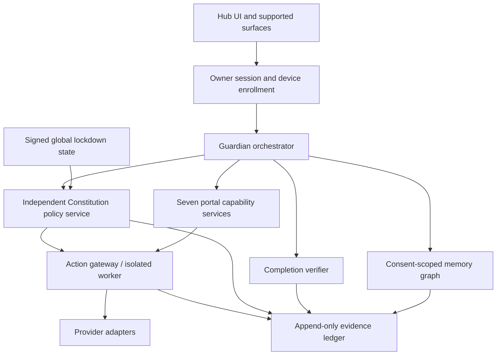

# STAARWAARDD Expansion — Architectural Gap and Improvement Report

## Current state

The implementation is a validated prototype foundation on branch `manus-expanded-m1-safety-contracts`, latest commit `34ae803a141cfc5b1b09687e0e655aef69edf863`.

Verification is green: **21/21 tests passed**, syntax checks passed, diff checks passed, and the branch is synchronized with GitHub. The existing cinematic Hub, portal behavior, assets, routes, approval copy, and deterministic planner remain preserved.

## What is still missing

| Priority | Missing capability | Current truth | Recommended improvement | Architectural benefit |
|---|---|---|---|---|
| P0 | Production identity and sessions | Prototype bearer-token gate only | Add a real owner/session service with rotation, expiry, recovery, device enrollment, and step-up authentication | Makes authorization attributable to a real owner rather than an environment secret |
| P0 | Remote durable audit ledger | Local JSONL persistence | Move receipts to an append-only remote store with server-side access control, retention, export, backup, and integrity checkpoints | Makes evidence durable across instances and devices |
| P0 | Action gateway isolation | Prepare-only in-process gateway | Add a separate policy-enforcing worker or service boundary with capability allowlists, idempotency keys, timeouts, retries, rollback, and provider receipts | Prevents a compromised model or web process from reaching side effects directly |
| P0 | Cross-device lockdown | Process-local lockdown | Propagate signed lockdown state to all authenticated sessions and device surfaces, including offline recovery behavior | Makes emergency control real across the product surface |
| P1 | Portal UI migration | Canonical Events and Well-being exist in API contracts; visual cards retain legacy labels | Perform a reviewed UI migration using canonical display names, stable internal IDs, asset aliases, route aliases, and migration tests | Aligns user-visible identity with the approved expanded contract without deleting Community functionality |
| P1 | Permission scopes and expiry | Approval is evaluated per request | Add scoped grants with purpose, portal, capability, data class, expiry, revocation, and consent receipts | Prevents broad or stale permissions from accumulating |
| P1 | Memory and consent graph | No persistent memory graph | Add consent-scoped memory items, provenance, visibility, deletion, export, retention, and relationship edges | Gives Guardian useful continuity without turning memory into uncontrolled surveillance |
| P1 | Cross-device presence | No session registry | Add explicit session/device presence with enrollment, active-surface selection, offline state, mic/camera consent, and revocation | Lets Guardian adapt to the active screen without ambient surveillance |
| P1 | Completion evidence store | Receipts reconstruct local task state | Add typed evidence artifacts, artifact hashes, test-run metadata, reviewer identity, acceptance history, and rejection reasons | Makes Milo and other pilots independently verifiable rather than self-asserted |
| P2 | Model router | Existing optional OpenAI planner plus deterministic fallback | Add provider-neutral adapters, capability and cost budgets, timeout policy, structured-output validation, and model-specific redaction | Makes intelligence replaceable and operationally predictable |
| P2 | Provider integration adapters | All providers disabled | Add one provider at a time behind the same portal capability contract, with sandbox credentials, dry-run mode, explicit scopes, and receipts | Allows real usefulness without collapsing safety boundaries |
| P2 | Accessibility validation | Existing accessible controls and reduced-motion behavior | Add automated axe/WCAG checks, keyboard-flow tests, screen-reader labels, captions/transcripts, contrast checks, and mobile assistive-technology passes | Makes the visible Guardian dependable for more users |
| P2 | Observability | Local audit receipts only | Add privacy-reviewed operational metrics for denials, failures, recovery, latency, and human revisions without behavioral surveillance | Shows whether Guardian is reliable while respecting the data boundary |
| P3 | Deployment and recovery | Branch is pushed; no production deployment | Add staged environments, migrations, backups, rollback, health checks, secret rotation, and release approvals | Turns the prototype into an operable product without bypassing founder control |

## Recommended architectural target

The key design choice is that the model and Guardian persona remain upstream of the policy boundary. They can propose plans and prepare drafts, but they never receive direct authority to execute side effects. Providers are adapters behind the gateway, not tools exposed directly to model output.

## How these improvements make the architecture better

### More trustworthy

A real session service, scoped permissions, signed lockdown, and isolated gateway would make it possible to prove who authorized an action, what was authorized, for how long, and whether the action actually occurred.

### More intelligent without becoming reckless

A memory graph, model router, and cross-portal context service would give Guardian better continuity and better prioritization. The Constitution would still decide what it is allowed to do.

### More coherent across devices

Presence, session sync, and shared lockdown would let the same Guardian adapt between phone, desktop, home display, and future companion surfaces without relying on invasive ambient sensing.

### More useful in the real world

Provider adapters would convert preparation receipts into real results one capability at a time. The product would retain a clear distinction between provider unavailable, draft prepared, action authorized, action submitted, provider confirmed, and user accepted.

### More auditable for Milo

Typed evidence artifacts, test-run receipts, artifact hashes, and explicit owner acceptance would give Milo a reliable first completion pilot. Guardian could identify missing requirements, coordinate approved production steps, verify outputs, and stop at user sign-off without inventing completion.

### Safer to operate

Remote audit durability, backups, rollback, health checks, and staged deployment would reduce operational risk. Privacy-reviewed metrics would reveal failures and recovery patterns without adding an unapproved surveillance layer.

## Suggested execution order

1. Production identity/session boundary and scoped owner authorization.
2. Remote audit store with backup, retention, export, and integrity checkpoints.
3. Isolated action gateway with dry-run and idempotent receipt handling.
4. Signed cross-device lockdown and presence registry.
5. Reviewed visible Events/Well-being UI migration.
6. Consent-scoped memory graph and completion evidence artifacts.
7. Provider-neutral model routing and one sandboxed provider adapter.
8. Accessibility automation and broader native/device validation.
9. Milo end-to-end pilot with explicit owner acceptance.
10. Staged deployment and production release gates.

## Non-negotiable guardrails

- Never let model output call providers directly.
- Never infer approval from silence.
- Never mark a task DONE without verification and owner acceptance.
- Never treat external content as instructions.
- Never expose personal, device, health, identity, or third-party data without scoped consent.
- Never replace approved Guardian identity, routes, assets, audio defaults, or portal history during migration.
